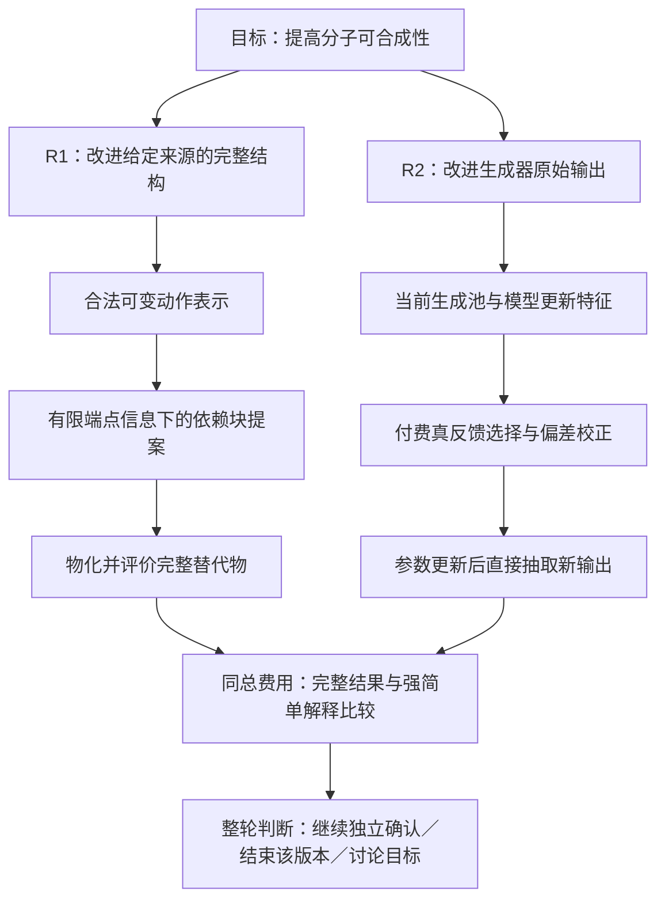

# 论文复核后的双路线研发方案

2026-10-21。研究设计讨论稿。先复核最接近的化学与跨领域原始方法，再形成两份可比较的研发候选。两条路线尚未选定，候选不是正式核心，也不是自动执行的实验队列。本文未新增训练、分子生成、物化、评分、路线搜索或远端作业；英文稿仍暂停。

## 2026-10-22方案优化补记

后续完成[具体算法与有限验证方案](G:/逆合成结构化反馈/route_refinement_20261022/双路线优化方案_具体算法与有限验证_20261022.md)：R1现域近上限且形成前上界已实际做过，不再扩大该实例；R2收敛到均匀图组采样与预测辅助残差更新，承认已知原理，用一次完整终端结果区分实际价值与贡献规模。下文R1扩测和R2梯度投影主动分数均为历史设计，不是当前队列。正式核心尚未采用，没有新计算；条件规模及估时以新文档为准。

## 2026-10-22进一步文献核查补记

已补[公式与代码级文献深查](G:/逆合成结构化反馈/literature_deepcheck_20261022/进一步文献调研_具体运算与研发判断_20261022.md)。BOCS/ChemBO等更直接限制R1二阶响应与联合采集的原创性；ASI/PP-SSL等表明R2残差校正及训练梯度有直接数学先例。分子领域Kajino2023已用于DR性能估计，RL–AL/DPP/SEGO的实际更新与本候选有明确区别。当前两简版应归为已有方法的化学适配候选，主要原创算法贡献尚未建立。下文作为10月21日的完整设计记录保留，其验证规模和天数不作为当前自动执行队列。最终目标、正式核心和论文状态未变；本次没有新科学计算。

## 1. 复核对方案产生的实际改变

最终目标仍是通过算法提高分子可合成性。当前主要可测端点为指定规划器、库存、模型与预算下的路线支持，不能将其称为实验合成成功或全部化学难度。RF/QED先报告，不擅自加入资格要求；也不新增同骨架、小编辑、多步反应等条件。

本次没有得到“两个原创算法已确认”的结论，得到的是两个**操作具体、可被否定、仍有贡献风险**的候选：

| 路线 | 研发对象 | 唯一主要改动 | 最终应改善什么 | 当前判断 |
|---|---|---|---|---|
| R1 给定分子的结构改进 | 来源条件下的合法结构动作 | 将可变动作对应、有限真实端点信息和成对条件响应接成联合提案选择运算 | 在共同预算上限下得到更好的完整替代物收益，并按实际费用解释 | 可保留，但一般依赖学习已有先例；化学适配增量尚未证实 |
| R2 生成器原始分布改进 | 有限真实反馈如何形成当前模型更新 | 按更新误差贡献分配评价，并用真反馈校正主动选择偏差 | 更新后未经修复、筛选的新原始输出获得更多路线支持 | 比“当前经验回放”更具体，但仍可能只是主动策略梯度的化学适配 |

不再作为独立新方法排实验的泛称：联合编辑、细分失败、成功案例检索、正负回放、按当前分布采集、多样性选择、四格信用、搜索后蒸馏。它们可能是必要组件，已有先例并不禁止使用；但需要把新增贡献落到具体运算和最终收益，不能靠组件列表承担创新。

R1和R2并列，不要求先做R1再蒸馏到R2。路线识别Q可以作为共同评价设施，不能把其独立收益归给结构或学习新机制。

## 2. 最近论文覆盖了什么

这是截至2026-10-21的聚焦近邻复核，不是系统综述或无撞车保证。先按状态、动作、反馈、更新和输出比较，再判断差别。可读全文、主源检索片段和旧核查分开列明；没有以同名/不同名作为判据。

### 2.1 路线一的强近邻

| 原始来源、阅读范围 | 已有操作 | 对本方案的约束 |
|---|---|---|
| [ReaSyn v2](https://arxiv.org/html/2509.16084v2)，本轮全文方法可读 | 双向子树重采样及整路径插入、删除、替换 | 共同修改、双向传播、树骨架重构均不足以单独报创新 |
| [SynCraft v1](https://arxiv.org/html/2512.20333v1)，本轮全文可读 | 悬崖对检索、理由和可执行原子编辑 | 历史类比指导结构修正已有直接先例 |
| [SynTwins预印本](https://arxiv.org/pdf/2507.02752)，本轮全文可读；正式版访问受限 | 部分逆合成、兼容前体检索、前体组合与前向重建 | 组合替换与库存闭合不能仅与弱随机编辑比；旧强A仍重要 |
| [SMER / SMER-Opt v1](https://arxiv.org/html/2605.10035v1)，本轮全文可读 | 端点差分拆动作、上下文编辑响应、多步MCTS | 编辑收益学习及多步组合已有操作级近邻；它可在新状态重打分，不能说它完全不能处理条件效应 |
| [L2E官方PDF](https://openreview.net/pdf?id=qEe4ypDaQp)，本轮仅检索可见摘要/片段 | 多轮编辑反馈与累计结果进入训练优势 | 不能宽泛主张逐步信用训练首创；全文访问缺口仍在 |
| [GOMEA Linkage Kernels](https://arxiv.org/pdf/2203.05970)，本轮PDF可读 | 每个解在局部邻域学习自己的依赖并联合混合 | 上下文相关的依赖块本身已有通用算法 |
| [条件RV-GOMEA](https://arxiv.org/html/2402.10757v1)，本轮全文可读 | 适应度差分检测依赖、重叠块条件采样 | 四格/差分发现依赖并联合采样也不是通用首创；源问题的廉价局部评价条件不能搬到CASP |

补充反对性近邻：[CCGBO](https://proceedings.mlr.press/v300/wei26a.html)本轮核对官方摘要；[DFRL-Mol](https://academic.oup.com/bib/article/27/5/bbag493/8790176)方法沿用已保存核查，本轮未逐式重读；[编辑相互作用的程序优化论文](https://doi.org/10.1145/3703920)仅出版主源检索片段。它们限制泛称信用、位置监督和真实撤销的创新表述，不据此认定我们的具体化学链条已经完全相同。

**复核结论：** R1不能停留在“把LNS/GOMEA搬到分子”。需要体现可变分子动作与合法重建的具体适配，并证明获取依赖信息的费用值得。相对ReaSyn或SMER操作不同，不等于相对所有优化方法已有新原理。

### 2.2 路线二的强近邻

| 原始来源、阅读范围 | 已有操作 | 对本方案的约束 |
|---|---|---|
| [S3-GFN v2](https://arxiv.org/html/2602.04119v2)，本轮全文可读 | 当前采样、正例训练、正负回放、外部搜索样本、约束适应 | 当前分布经验、正负反馈、搜索补经验已有直接先例 |
| [Saturn v1](https://arxiv.org/html/2405.17066v1)，本轮全文可读；[Augmented Memory](https://pmc.ncbi.nlm.nih.gov/articles/PMC11200228/)本轮主源检索方法片段 | 高奖励回放、SMILES增广、多次更新、记忆清除及可选外部搜索 | 提升反馈复用或更新次数不能当作新机制收益 |
| [RL–AL](https://pmc.ncbi.nlm.nih.gov/articles/PMC10935729/)，主源检索较长方法片段；完整页受验证阻断 | 当前生成批次上由代理选择真实评价，更新代理和生成器，讨论伪标签权重 | 当前生成池主动取真反馈已有先例；本轮不声称取得完整全文页面 |
| [SEGO v1](https://arxiv.org/html/2607.12488v1)，本轮全文可读 | 代理引导候选生成、EI采集、真实反馈更新锚定模型 | 代理引导＋主动评价＋生成器更新不是空白 |
| [Diverse Mini-Batch Selection v1](https://arxiv.org/html/2506.21158v1)，本轮全文可读；AAMAS正式PDF体积受限 | 当前大批轨迹经DPP选择小批，只评价小批再更新 | 当前分布加结构多样反馈选择已有具体实现 |
| [Diversity-Aware RL](https://www.ijcai.org/proceedings/2025/1022.pdf)，本轮官方全文可读 | 多样性内在奖励、集合新增覆盖、适应惩罚等 | 有限预算覆盖不能单独作为新目标或新算法 |
| [SynthSense](https://pubs.rsc.org/en/content/articlehtml/2026/sc/d5sc09263a)，本轮出版社主源检索片段，全文403 | 部分路线信号及批级合成激励 | 细粒度反馈、部分树或集合奖励不能泛称首创 |
| [Deep Bayesian Quadrature Policy Optimization](https://arxiv.org/html/2006.15637v1)，本轮全文可读 | 把策略梯度作为积分估计，估计其不确定性并改善更新 | 关注模型更新方向的不确定性已有跨域方法；不能宣称首次提出这一原理 |

**复核结论：** R2须区别“优先找到高分分子”和“可靠地改变当前生成器”这两个决策。可以研究前者如何服务后者，但主动学习、控制变量和重要性校正本身不是我们的原创。

### 2.3 新检索与迁移边界

另核对2026-10-06的[Information-Dense Synthesis](https://arxiv.org/html/2610.08495v1)全文：它通过可控混合物与池测提供多对象信息。本文不将其混合物测量假设搬到独立CASP查询，也不把其稀疏无先验设定下的结论推广成“我们必然学不动”。当前月的[bioRxiv合成生成预印本](https://www.biorxiv.org/content/10.64898/2026.10.01.755933v1.full)全文访问403，只列为待核对近邻，不根据摘要确立新颖性。

## 3. 旧结果怎样改变新设计

| 事实 | 对新设计的直接约束 |
|---|---|
| 严格旧512：原133、A276、B361、C303；B/S共同双规划器298对257–258 | 保留既有算法作用；不声称过去只有门槛让步 |
| 无RF/QED旧358：A328、B319；新1015位置A_Q1013、B_Q1008，B−A未知边界[-7,0] | 不再原样续测无性质B，不靠同域扩大样本争取已有主要比较翻转 |
| Q旧128来源103对99 | 保留识别与费用价值，但结构/生成方法比较中保持识别端一致 |
| 五组真实回退：四组单块足够，一组仅联合成功 | 工具和条件例证可复用；不能训练一个五例模型后宣称发现普遍协同；不能按已知两端挑新验证来源 |
| 三臂Graph10/13/14实际task_only | 不能以此否定纯合成目标学习 |
| 直接标量两种子Graph10→14、15→14；AiZ9→12、13→11；有界路线奖励收益有限 | 简单路线学习已做过，不能仅换奖励名再报新方法；新规则需超过普通学习解释 |

旧checkpoint、完整评价、候选物化、角色约束、回退、采样与Q接口继续利用。旧224个路线阳性可供开发，不等于224个修复对或新的独立确认。复用要求身份和评价条件可比，不能修补来源选择偏差。

## 4. R1完整研发方案：有限反馈下的条件联合提案

### 4.1 研究问题与输出

给定一个来源分子，能否在同总费用下，用更有用的联合动作获得比强简单构造更多有路线支持的完整替代物？

输出包含完整分子、相对来源的实际改动、路线见证及总费用。用途与来源关系需要保留明确含义；在尚未约定用途时，报告结构变化前沿，不事后用某个距离阈值挑阳性。不能通过对所有来源返回同一个容易的库存分子证明“来源修复”。这不等于新增同骨架或小编辑限制。

### 4.2 表示和可执行动作

写成m=T(x,z)。x为来源，z为结构动作赋值，T为现有或必要扩充的合法物化器。每个动作保留原子/键事件、连接位置、局部环境与反应角色，使不同来源的可变动作可用共享描述对齐；不要求具体编辑完全重复。

需要分开两种关系：

1. 确定的结构/角色兼容关系，用于判断能否物化。
2. 经验性的完整分子路线响应关系，用于估计哪些动作共同改变更值得尝试。

第二种关系不是化学禁则。正常预算未解为协议端点0；技术未知不填0；未评价组合不补成负例。

### 4.3 初版关键运算

初版只研究一种联合提案规则，不同时开发新生成器、新反应模型、失败课程或LLM解释。

1. 用旧完整端点建立普通终端响应模型；仅在真实组合观察覆盖处估计条件响应，不从五个四格拟合庞大网络。
2. 动作主效应与成对条件项分开表达。一个可执行起始参数化为

   logit p(Y=1|x,z)=b(x)+Σ_i u(x,e_i,z_i)+Σ_(i,j) v(x,e_i,e_j,z_i,z_j)。

   这是已有统计/因子建模思想，不作为原创；v不带数据时回到无交互预测，不能把先验或缺失当发现。
3. 初版动作块仅为单动作与双动作，双动作覆盖当前可兼容组合，不要求两者在反应树上相邻。块内从已有合法动作取值生成联合提案；没有动作的来源保留未覆盖。双动作是这一研发版本的计算范围，不据此否定更高阶依赖。
4. 给每个待评价提案一个明确分数：用按来源重采样的响应模型集合预测完整候选成功概率，按“预测均值＋一个预测标准差”除以预计增量费用排序；提案比较时不设置中间单动作改善门槛。费用估计用已有同执行器测量，初版无可比费用时用共同单次上限，不凭空估计便宜。取得新完整端点后更新响应模型并重新排序，直到来源预算用尽或取得所需输出。若多个分数相同，使用可记录的随机次序。该UCB式选择是已知方法，不单独报创新。
5. 依赖关系通过成对项改变双动作提案的预测与排序；初版不为了构造四格强制补齐其他三个端点。只有该实际被选提案接受昂贵评价，全部计入来源预算。用于计算的“联合预测超过单动作预测”等数只作诊断，不能充当真端点或化学协同证据。
6. 物化失败保留费用与失败位置，不作路线负例；单次未解保留评价条件。结束来源后返回已实际支持的完整结果，没有结果和未覆盖同样保留。新模型的重拟合与特征计算也计费。

这给出一个确定的初版结构：单/双动作提案、含条件项的响应模型、按费用排序的UCB、实际完整端点更新。正则强度与动作表示等实现参数只在已有开发记录中选择，不能在看到终端输赢后轮换解释。如果成对项没有足够观察支撑，应明确退化为普通响应模型；不能把模型外推写成发现依赖。若现有覆盖不足以支撑有区别的联合选择，或只得到通用GOMEA/代理优化直接移植，结束这个候选的新增贡献主张，不转成无限补组合标签。

初版尚没有从大量动作中学习分组的单独运算；它是单/双动作机会上的成对响应选择，不能描述成已学到任意高阶依赖块。各政策从相同开发资料出发，只使用本政策在主验证中已经取得的反馈。若允许跨来源在线共享，各政策按相同来源顺序独立累积并分别计费，不把后续来源结果回填早期选择，也不用某政策验证反馈替其他政策训练。

### 4.4 相对已有方法必须回答什么

| 对照解释 | 本候选必须多做到什么 |
|---|---|
| 旧A / SynTwins式组合重建 | 收益超过普通前体供给与重建，不靠性质资格改变 |
| ReaSyn式树联合编辑 | 成对响应改变联合提案选择的运算有价值，而非仅扩大子树 |
| SMER式单动作响应＋多步搜索 | 单动作重评分已能解释的部分不能归给联合依赖 |
| GOMEA局部linkage移植 | 可变合法化学动作与昂贵不完备反馈的适配带来实际区别和收益 |

不要求所有原论文全套大规模训练才能基本否定候选。初轮可以用同执行器下的最接近机制实现作比较；但这只能定位运算，不能据此宣称完整击败作者原生方法。正式主张若针对某方法，后续必须有相应可比实现或清晰限制。

### 4.5 一轮基本验证

默认规模参考64–128个来源，最终按实现成本和来源聚集决定。来源不得按本轮候选输赢选择；可将“原结构在共同协议未解”定义为预先明确的救援对象，不能按已知成功替代物选取。全体来源与条件未解结果分别报告。

最小完整比较为：新政策、强A、拥有同类联合机会的普通联合政策。后者可实现为直接linkage/普通联合重建参照；不能把同组中的弱随机当唯一对手。若需要区分学习分组与直接linkage，再在共同已评价机会中作机制解释，不机械扩为许多臂。

核心是来源配对的完整结果及总成本，含救回、改坏、不同产物、结构变化、未覆盖与技术未知。若贡献在选择，比较共同动作机会；若贡献在新增动作，允许扩动作域，同时解释供给和选择，不能强迫新方法继承旧A上限。

**应支持的论点：** 在给定用途/来源关系和预算内，新的结构决策运算改善完整替代物的合成支持。不能仅用依赖图、交互分类精度或四格非零支持这个论点。

### 4.6 结束条件

如果普通联合操作同样有效、依赖学习费用抵消收益、只在已知成功来源成立、收益主要来自更大结构偏移而没有可解释用途，或尚无可部署动作表达，则结束此版本。预算端点的一个联合阳性不触发扩块数、增阈值、换模型。结果区间较宽时先判断潜在收益是否值得追加，不自动把未显著变成继续理由。

## 5. R2完整研发方案：为生成器更新分配合成评价

### 5.1 研究问题与目标

有限的真路线反馈，怎样更可靠地改善当前生成器，而不仅挑出一批看起来较好的候选？

设s为完整生成序列，m=canon(s)，目标为J(θ)=E_(s~qθ)[r_e(m)]，e表示评价条件。先以纯合成端点研发，RF/QED作分布报告，是否保留任务目标由作者依据结果讨论。不同成功分子数、库存命中、重复与结构覆盖用于解释，暂不自动改成集合优化目标。

最终交付是更新后的生成器。停止训练后直接抽取原始输出，不用代理筛选、不接B修复、不以查询子集成功率替代总体结果。

### 5.2 核心：从“评价哪个分子”连接到“怎样更新”

每轮由当前模型抽取N条原始完整序列s_i，保留重复及无效尝试。对这些序列计算ψ_i=∇θ log qθ(s_i)。不同SMILES可共享同一图的评价，但在梯度中仍保留各序列的贡献。化学解析无效的输出按共同协议Y=μ=0，无需路线调用，仍保留在N中；不能只采有效分子改变目标分母。

用查询前的历史数据构建奖励预测μ_i和残差不确定性。旧数据只用于模型/控制项，不冒充当前策略的无偏标签样本。查询依据同时考虑：奖励估计可能错多少、该样本影响当前更新的程度、评价费用。

初版使用可计算的梯度投影h_i和残差二阶矩估计v_i构成启发式分数，如sqrt(v_i·||h_i||²/c_i)，并与均匀抽样混合得到p_i>0。这个式子是候选启发式，不声称在相关奖励、投影误差和实际费用下严格最优。投影可以用现有模型小参数子空间，不重新训练大架构。

按p有放回抽K个索引取得真路线反馈。模型更新使用：

\[
\widehat g=\frac1N\sum_{i=1}^N\mu_i\psi_i
+\frac1K\sum_{j=1}^K\frac{(Y_{i_j}-\mu_{i_j})\psi_{i_j}}{N p_{i_j}}.
\]

第一项利用全池预测形成估计；第二项用真实反馈校正预测误差与主动选择偏差。给定当前池、查询前确定的μ和已知非零p，在标签协议可比时，对索引抽样的条件期望是池内完整反馈梯度。该代数恒等式来自普通控制变量/重要性估计，不是我们的新定理。

实施时将μ、p和ψ的本轮取值当作梯度估计中的系数处理，不对μ或抽样概率反向传播；参数更新后重新形成下一轮池。若使用先验约束，各臂共同使用同一规则并计费用，不将奖励/先验拆分本身作为创新。

本轮只改**查询分配与对应更新估计**，不加失败解释、结构修复、集合奖励或在线发明新课程。

### 5.3 这个校正能做什么，不能做什么

- 它校正当前池内的部分标签选择，不能消除旧来源选择偏差、规划器误差或代理失校准。
- p由投影决定不影响上述池内代数期望，但不保证降低完整梯度的方差。
- 有放回K次抽取可能有重复；估计中保留次数。同身份、同条件结果可复用，实际新查询费据实记录。不能擅改为“抽到K个不同分子才停”。
- 若研究随机规划成功概率，一次缓存结果不等于多次独立搜索。采用固定协议结果与独立重复搜索对应不同目标和费用，需要分开。
- 本轮μ不能偷看待校正标签；确定性Top-K、错误p、权重裁剪或不记录抽样过程会改变期望。初版不靠裁剪制造稳定性。
- 技术未知保留，不填0；若真反馈未完成，不能按完整反馈宣称该批估计无偏。按既有错误恢复处理，并保留实际成本。

### 5.4 相对近邻的具体差别和风险

相对RL–AL/SEGO，新候选关注有限反馈对**当前模型更新误差**的贡献，而非主要最大化查询候选的预测奖励/EI。相对DPP，不仅按结构距离选；相对AM/S3-GFN，不增加经验库或梯度次数作为主要改动。相对DBQPG、主动策略梯度和控制变量，它没有新的通用原理保证。

因此当前可讨论的增量是：在分子序列/图身份、路线随机性与昂贵反馈条件下，形成一个可计费、可校正的具体查询—更新运算，是否比强简单策略更有效。**这仍可能只是应用适配，不能预先承诺足够投稿。**

### 5.5 一轮完整基本验证

开发时优先使用确有完整池、共同checkpoint与可比反馈的旧批次，遮住部分标签作计算重采样，比较完整池参考梯度下的估计误差和计算费用。这只是开发诊断，不是新生成证据。旧池不合适则不单独扩成采集任务，在完整基本验证中一次记录。

初轮工作量参考：3种完整政策×3个匹配训练种子，每运行至多两个预先说明的反馈轮次；每轮例如128条候选、32次索引抽取。该例最多576个训练反馈索引，不保证576个不同新查询。实际预算以新标签、路线调用和墙钟分别记录，不用索引数冒充费用相同。

初版采用每轮固定K个索引，不采用“花到相同真实查询费才停止”的随机K。各政策有相同索引/轮次上限，实际新标签和时间可能不同，必须比较最终收益与实际费用，不称为严格同费试验。若候选更贵且收益不足以抵偿，不能据成功率较高主张效率优势。若后续需要严格的费用停时设计，应重新推导对应估计；不能在实现中直接改停时却沿用上式的无偏表述。

最小政策为：候选运算、均匀查询的相同更新器、一个最接近的强主动/成功经验政策。选择第三者时依据候选实际机制，优先采用可用的RL–AL/DPP型查询或现有强化回放，而非挑最弱对照。共同更新器可以定位查询作用；若第三者用原生更新，结论定位为完整政策，不能声称所有差别只来自查询。不要自动展开全部回放/奖励五臂。

每个训练运行完成后独立抽128个原始终端输出，共1152个输出，另保留初始模型参照。基本效应的独立单位是训练运行，不是1152个分子。首先报告所有采样尝试的成功率，再报告不同成功图、精确记忆命中、重复、库存占比、结构和性质分布。采用共同外部规划器评价可以检查对训练评价器的适配，但仍不等于实验合成。

**应支持的论点：** 在有限真反馈总费用下，新查询—更新运算改善生成器新原始输出的合成支持，并超出普通终端反馈/成功回放的解释。梯度误差降低、模型AUC或查询子集成功率只作机制证据。

### 5.6 结束条件

校正方差抵消收益、普通均匀/主动策略同样有效、原始输出未改善、收益只由更多查询或更新解释、或者只是重复少量易解库存结构时，结束此版，不自动换不确定性分数、加轮次、换损失继续。近邻全文/代码若确认已充分覆盖同一运算，也应重新评估贡献，不能靠跑出正数绕过。

## 6. 两条路线的贡献、风险和费用比较

| 维度 | R1 | R2 |
|---|---|---|
| 与最终目标的连接 | 直接改变完整结构 | 直接改变后续原始生成分布 |
| 与最初“反馈能改善以后输出”的联系 | 若依赖能跨来源共享则成立；纯逐例搜索不能声称生成器学会 | 更直接，但需要训练运行与终端新输出证据 |
| 现有资产复用 | 高：执行器、角色、前体、组合端点、回退和Q | 高：生成器、checkpoint、采样、奖励接口、旧路线标签 |
| 最重要未知 | 可变动作覆盖是否足够；学习依赖的费用能否偿还 | 代理误差/重要性权重能否带来更低更新误差和更好终端结果 |
| 创新性风险 | 高：普通联合搜索及GOMEA适配可解释 | 中高至高：主动RL/DBQPG/回放可解释，暂无正面贡献证据 |
| 初轮计算压力 | 主要为形成与完整路线查询 | 反向特征、查询、训练及终端评价，通常更高 |
| 已明确不做 | 原样B＋Q扩样、四格个案续补 | 再证明参数改变、普通回放换名、默认叠加细失败分类 |

两条均为候选，不能把“R2更贴近学习故事”当作算法优越证据，也不能因R1设施现成而自动选择它。无需为了利用所有旧成果强行合并；资产作为开发、对照、排除证据和复现工具同样有价值。

## 7. 条件排程与时间边界

本轮论文复核与方案制定已完成；以下是后续研发预算，不是已启动的作业。长任务开始前按作者要求说明具体设备、任务和预计占用，当前不重新盘点空闲卡。

| 工作 | R1预算 | R2预算 | 交付/决定 |
|---|---|---|---|
| 将候选收成单一可执行实现并核对直接近邻 | 约1–2有效工作日 | 约1–2有效工作日 | 具体算子、信息来源、费用、与强解释的差别；若只剩直接移植，结束新贡献开发 |
| 实现与必要开发测量 | 约2–4有效工作日 | 约3–5有效工作日 | 完整运行器；复用可比记录，不另开无限小试 |
| 一次基本验证与整体分析 | 约1–2有效工作日 | 约2–3有效工作日 | 一份整体去留报告，不逐个阳性续开模块 |
| 若全部顺利的整轮工作预算 | 约4–8有效工作日 | 约6–10有效工作日 | 不承诺算法成功或投稿日期；前提失败即提前报告 |

相较此前2–4日/4–7日的粗估，本次增加了明确的新算子与最近机制适配，不能沿用旧接口接通耗时来承诺整个研发完成。

历史测量锚点：128来源×2结构政策双卡约17分钟，1015位置×4政策约4小时28分；直接路线反馈短训练约27分钟/运行；32个终端分子双规划器约18–20分钟/模型。它们是旧条件测量，不是新配置线性保证。

R1的64–128来源、2–3政策，旧接口下评价可为数小时；新联合形成和依赖查询可能主导，先按约2–12小时科学计算工作量作排程范围。R2示例1152终端输出的双规划器评价约11–12小时串行参考，加最多576个训练反馈索引、反向特征与更新，先按约20–40小时串行科学工作量预留。有效多设备并行可缩短墙钟，但不能保证按卡数等比缩短。若新实现测量明显超出范围，应先整体重估，不自动延长。

初轮规模只能观察较大的可用效应及成本，不能保证识别几百分点收益。没有完整方法基本结果和训练运行波动前，不给正式实验结束或论文成稿日期。

## 8. 整轮结束后只有三类安排

1. **完整收益成立且方法差别实质。** 讨论是否采用候选核心，再做必要独立确认及正式比较；不立即补写论文宣称已完成。
2. **有作用，但普通方法同样解释。** 保留工程/应用成果，结束该新增机制的主要贡献主张；不能用更多同类案例代替原创性。
3. **没有完整收益、信息不可得或成本不值。** 结束该候选，回到两条输出路线与研究目标层面讨论，不自动接下一种网络、奖励或分类。

不要求所有指标同时改善；但提高成功率、结构/分布改变和额外费用必须一起解释。未知结果先说明不确定性和追加观察能否改变投入决定，不默认扩样。

## 9. 本轮检索记录与证据边界

日期：2026-10-21。以arXiv、PMC/期刊、官方会议页、作者机构/仓库为主。采用主源检索与有范围的全文/方法复核，没有宣称穷尽数据库或完成PRISMA筛选，未安装额外检索依赖。

根检索串包含：

- molecular large neighborhood search synthesis optimization
- synthesizability counterfactual molecular optimization
- molecule failed synthesis reinforcement learning feedback
- synthesis-aware dependency molecular optimization
- molecular synthesis dependency interaction graph joint edit optimization large neighborhood search
- molecular reinforcement learning counterfactual replay influence gradient sample selection synthesis
- molecule synthesis contrastive failure optimization
- SynthSense Fill Plate
- molecular gene-pool mixing；molecule linkage learning；linkage synthesis molecular optimization
- molecular generation censored；molecular policy gradient credit assignment synthesis；molecular repair preference optimization
- policy gradient reward query variance active；policy gradient label importance active learning
- molecular gradient active learning reinforcement；reward acquisition gradient estimation reinforcement learning

两条并行复核的针对性检索、访问级别与具体版本分别保存在下列工作笔记。不把多个AI意见一致算作独立证据，不把受限全文假装读完，不根据“未搜到同名”保证原创。

配套：

- [路线一论文复核工作笔记](G:/逆合成结构化反馈/research_route_reframe_20261021/路线一论文复核_工作笔记.md)
- [路线二论文复核工作笔记](G:/逆合成结构化反馈/research_route_reframe_20261021/路线二论文复核_工作笔记.md)
- [双路线旧证据复核工作笔记](G:/逆合成结构化反馈/research_route_reframe_20261021/双路线旧证据复核_工作笔记.md)
- [前轮问题结构与跨领域映射](G:/逆合成结构化反馈/research_route_reframe_20261021/问题结构拆解与跨领域方法映射_20261021.md)

本轮只完成文献复核、设计和本地文件整理。没有启动新实验、连接设备、修改正式核心或论文，也没有自动安排两路并行长任务。
