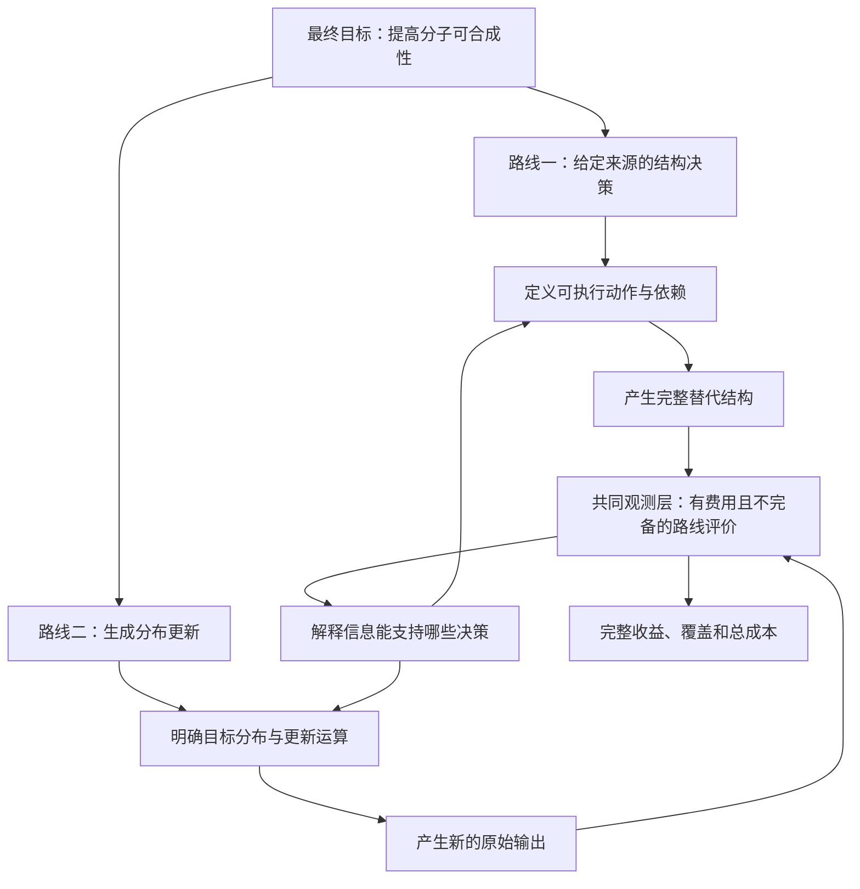

# 问题结构拆解与跨领域方法映射

2026-10-21。研究设计讨论稿。按作者要求，从问题形式、结构和可执行运算寻找跨领域类比；不先选择RL、LLM或某种反馈格式。两条路线尚未选定，本稿不修改正式核心，不启动实验或论文写作。

文中“事实”来自已保存实验或明确标注的文献；“类比”说明结构对应；“迁移设想”尚未被本项目验证。借鉴存在不等于化学适配新颖，多个AI意见一致也不是证据。

## 一、先把研究中的三个对象分开

最终目标仍是**提高分子可合成性**。当前主要可用的计算证据，是指定规划器、库存与预算下的路线支持；这个端点不等于实验合成成功，也不是最终目标的全部含义。

我们实际控制三种不同对象：

| 层次 | 状态与输入 | 能改变什么 | 输出 | 变化怎样才连接目标 |
|---|---|---|---|---|
| 结构决策 | 来源分子、可用构造/编辑、历史观察 | 前体、连接、片段、构造组合等 | 一个新的完整分子 | 改后结构相对可比较方法获得更多合成支持 |
| 观测决策 | 分子、规划器、库存、预算、随机状态 | 评价哪一个、用什么配置、何时结束 | 路线见证、正常未解、技术未知及费用 | 观察影响后续结构或生成决策；单独改善识别另计 |
| 分布更新 | 初始生成器、已有反馈、当前输出 | 参数、采样或经验使用规则 | 更新后的生成分布 | 未经额外修复/筛选的新输出发生改善 |

路线一主要交付结构决策；路线二主要交付分布更新。观测决策服务两者，不自动成为第三条主线。它们可以共享设施，但没有必须“先修复、再学习”的依赖。

## 二、共同数学形式与不能省略的区别

令来源结构为 \(x\)，结构决策为 \(z\)，实际执行器得到完整分子

\[
m=T(x,z).
\]

\(T\)可能没有合法输出；输出合法也不表示路线已经成立。生成路线则直接令 \(m\sim q_\theta(m)\)，更新 \(\theta\)或采样规则改变未来分布。

一次查询应写作

\[
q=(m,P,I,b,s),\qquad O_q=(\text{状态},\text{见证/记录},\text{费用}),
\]

其中规划器\(P\)、库存\(I\)、预算\(b\)、随机状态\(s\)都会影响观察。若还依赖反应库、模型版本等，应随已有记录解释，不把不同条件下的数混为同一标签。

对指定协议：找到可审查路线为1，正常预算耗尽为0；技术异常或未完成为未知。**0是本次计算端点的观测，不是化学不可合成证明。** 成功见证也不证明实验反应必定成功。

由此得到问题结构：**离散决策有依赖；检查昂贵且不完备；历史记录有选择性；学习又会改变未来需要处理的分布。** 这比“从失败中学习”更能指明需要借鉴什么，但它仍是研究问题的描述，不是已采用的论文核心。

## 三、拆成九个子问题，再找对应领域

| 子问题 | 问题形式/结构 | 结构相似的其他问题 | 借鉴的核心运算 | 应改变的最终决策 |
|---|---|---|---|---|
| P1 哪些结构决策必须一起改变 | 约束耦合，单变量邻域可能被困 | 车辆调度、排程的大邻域搜索 | 释放相关决策块，再联合重构 | 怎样产生替代分子 |
| P2 哪条反馈能影响其他设计 | 便宜主设计＋昂贵子问题，反馈强度不一 | 逻辑型Benders、约束推理 | 只推广仍有依据的推论 | 排除重复无效构造或复用可执行部分 |
| P3 怎样保留备选且避免重复枚举 | 多条序列共享中间对象，贪心选定有风险 | 编译器重写、共享表达图 | 保留备选、共享相同对象、延后抽取 | 同费用下考虑哪些完整结构 |
| P4 没被发现是否等于不存在 | 潜在状态与被观察机制混合 | 选择性标注、正例—未标注学习 | 区分状态与发现条件 | 如何解释和使用反馈 |
| P5 下一次昂贵观察该做什么 | 付费观察，最终只在乎行动收益 | 排序选择、知识梯度、计算价值 | 按观察对最终决策的预期作用分配费用 | 评价哪个结构/经验，而非只求不确定性下降 |
| P6 旧记录能评价新策略吗 | 只观察已选行动的结果 | 推荐系统离线策略评价 | 检查行动支持；满足条件才重加权 | 哪些旧结果可复用，哪些需新观察 |
| P7 要把生成器推向什么分布 | 事件条件采样，有限阳性反馈 | 可靠性模拟、自适应提议分布 | 拟合目标分布，而非无限强化少数产物 | 怎样更新采样概率 |
| P8 旧经验为何对新输出失效 | 策略改变自身遇到的数据 | 机器人交互模仿、学习引导程序求解 | 在当前访问分布上组织经验 | 下一阶段学哪些经验、怎样迁移 |
| P9 成功率高为何仍缺有效产物 | 有限使用次数，重复的边际价值下降 | 传感器覆盖、集合优化 | 以实际使用规模理解覆盖收益 | 更新或选择是否过分集中 |

九个子问题不等于九个实验任务。其中P4/P6首先用于正确使用旧证据；P2/P3可能只是设施改进；P1或P7—P9中的具体决策，才可能成为所选路线的方法研发对象。

## 四、P1：借鉴大邻域搜索，改变“修改单位”

**对方解决什么：** 调度中的容量、先后顺序和时间窗相互牵连，单独移动一项安排可能无效。大邻域搜索考虑成组释放和重新安排；ALNS还依据历史表现调整不同子启发式的使用。[Ropke与Pisinger原始研究](https://pubsonline.informs.org/doi/10.1287/trsc.1050.0135)。

**结构对应：** 客户/时段安排对应前体、连接和反应角色选择；调度依赖对应结构构造依赖；重新插入对应联合选取合法替代。完整调度的合法性只对应我们得到合法分子，路线支持仍需另外观察。

**迁移设想：** 决策单元不必始终是一个原子或一个片段。可以按共享连接、共同反应角色或实际构造依赖选出一组决策，保留其余上下文，一次联合重构。关键是“为什么这些选择应一起改变”，不是机械增加编辑数或逐一试两块、三块、四块。

**与旧成果关系：** 前沿修复、两步传播、联合替代和五组回退都相关，不能换LNS名称重做。一个0001四格只说明该例在指定预算端点下需要联合，不证明这种需求普遍，也不证明原子化学协同。

**判别观察：** 新的块定义/重构，是否在同用途、可比较总费用下超过已有独立编辑和普通联合操作？分别测动作供给与选择作用；若只是更多组合带来收益，应按其真实贡献报告。无新增可用动作或完整收益，结束这个设计。

**当前定位：** 对路线一最直接的动作组织参照；没有证实新的化学适配或原创性。

## 五、P2：借鉴Benders，学习“哪些推论允许推广”

**对方解决什么：** 主问题先选部分设计，昂贵子问题检查其余安排，再用有效推理缩小后续设计空间。逻辑型Benders要求说明推理在哪些其他赋值下仍然成立。[Hooker与Ottosson作者稿](https://johnhooker.tepper.cmu.edu/benders.pdf)。

**结构对应：** 编辑/前体组合是主设计；物化与路线搜索是子问题。明确的角色不兼容、图不合法、当前库存事实，可在其适用范围内复用；本次预算未解不能成为化学不可行证书。

**可借操作：** 将“确定的执行事实”“有条件的成功见证”“经验性的未解”区别对待。前者可以避免重复无效构造；已见子构造可支持相应上下文复用；未解只支持对该计算端点的经验判断。若使用统计预测，保留其预测身份，不能称为严格排除证明。

**与旧成果关系：** 角色约束、库存检查、中心与查询复用已有实现。只有历史中存在尚未利用、能影响后续结构决策的可靠依赖，这一借鉴才有新增价值。它不要求先发明失败分类体系，也不是新增工程门禁。

**判别观察：** 已有可靠依赖能否在不错误排除已知成功结构的情况下，减少无效构造并增加完整成功？若只是现有缓存/合法性检查，归为工程复用；若没有可推广依据，不继续开发硬排除机制。

**当前定位：** 主要是反馈使用边界，不建议直接把“不完备CASP＋Benders”命名为新主算法。

## 六、P3：借鉴编译器，保留备选但不冒认等价

**对方解决什么：** 等式饱和保留许多等价程序表达，使用共享表示，最后抽取合适的完整程序，缓解重写顺序问题。[egg原论文](https://homes.cs.washington.edu/~cnandi/docs/popl21-cr.pdf)。

**结构对应：** 我们也可能过早选定某个前体，从而失去后续组合；不同构造路径又可能共享完全相同的中间对象。

**能借什么：** 用有共享部分的候选构造图保留不同备选，记录可合法组合的关系，最后按完整产物评价。相同对象与相同计算上下文可以复用，不必反复展开。

**不能借什么：** 不同分子通常不具有程序语义等价关系，不能将相似分子合并为同一等价类，不能沿类传播路线成功或功能，也不能继承原方法的正确性与简单最优抽取保证。

**与旧成果关系及判别：** 候选池、路线缓存已做了一部分。应与普通枚举加现有缓存比较：同费用下是否保留更多关键完整候选并改善最终结果？只减少内存或增加缓存命中，属于实现成果，不能替代主要结构贡献。

**当前定位：** 有价值的表示参照，但不是目前优先独立研发的主线。

## 七、P4：借鉴选择性标注，先分清状态与发现

**对方解决什么：** 某些目标存在却未被诊断/收录，阳性标签的出现还依赖发现过程。SAR类正例—未标注学习显式考虑标注概率及其假设。[Bekker与Davis原论文](https://proceedings.mlr.press/v94/bekker18a.html)。

**结构对应：** 规划器发现路线的概率依赖结构、库存、资源与搜索配置。旧1002条中224个AiZ成功，不意味着其余778个在化学上不可合成；Q能改变同一结构的发现结果，也说明观测机制有作用。

**可立即借鉴：** 用\(p(\text{本次路线成功}\mid m,P,I,b)\)解释条件端点，不让同一个分数同时代表化学难度和搜索偏好。不同规划器的结果可作条件敏感性，而不是直接表决得到真值。

**关键边界：** 如果目标是固定预算内是否成功，正常未解就是观测到的0，普通二元学习可以使用它，不需要强行套PU。若想推断潜在化学可合成性，则现有计算标签未必满足阳性可靠、选择机制可识别等条件。仅有成功/未解通常不能分离“目标状态”与“发现概率”。

**判别观察：** 优先复用同结构的已存跨条件结果，看条件建模是否真的改变后续结构或更新决策；没有这种决策差异，不因标签可以细分而启动新模型。

**当前定位：** 立即采用的解释原则；不是新增化学分类任务。

## 八、P5：借鉴知识梯度与计算价值，评价“这条信息值不值”

**对方解决什么：** 在多个未知质量的方案中付费测量，最终要选好方案。知识梯度关心观测后最终选择的预期改善；计算价值进一步区分现实动作与为选择动作而做的计算。[知识梯度原文](https://optimallearning.princeton.edu/Papers/Frazier%20Powell%20Dayanik%20CorrelatedKnowledgeGradientJOC.pdf)、[Selecting Computations作者稿](https://people.eecs.berkeley.edu/~russell/papers/uai12-meta.pdf)。

对“最终选一个行动”的示意形式是

\[
V(q)=\mathbb E_{O_q}\left[\max_a\mathbb E[U(a)\mid D,O_q]\right]
-\max_a\mathbb E[U(a)\mid D].
\]

这是方法结构的说明，不是已实现的采集函数。费用进入有限预算决策；简单除以费用只是可能的启发式。若目标是收集一批产物，应把\(U\)改为集合的价值，不能照搬“最终选一个”的准则。

**结构对应：** 路线一的行动是结构改变/最终替代物，查询是候选或其某项评价；路线二的行动涉及经验或更新，效用要落到更新后的新输出。最高不确定性、最详细原因，都未必最能改善最终决策。

**迁移限制：** 原知识梯度论文的相关正态信念与误差假设不适用于直接套二元CASP；计算价值的近似也可能过早停止。若联合信息才有用，一次只看一个查询的收益可能漏掉它。为估查询价值反复模拟训练，还可能比省下的查询更贵。

**与旧成果关系：** 根覆盖与Q已有预算分配/识别证据，不能将VOI改名当新增贡献。五组回退有新增观察，但尚未证明比普通观察更会指导后续选择；不重查这五组演示案例。

**判别观察：** 同总费用下，决策导向观察相对普通顺序或简单不确定性选择，是否改善最终结构/分布？若只是知道更多而终端不变，则停止这项采集设计。

**当前定位：** 仅在具体方法确需额外反馈时考虑，不能因可做主动学习就单独开线。

## 九、P6：借鉴推荐系统，知道旧数据何时不能回答

**对方解决什么：** 日志只记录展示过的推荐及结果，新策略却可能选择别的行动。离线策略评价用结果模型、选择概率及其组合处理这种偏差，依赖行动覆盖等条件。[Dudík等ICML原论文](https://icml.cc/2011/papers/554_icmlpaper.pdf)。

**结构对应：** 来源/库存/反应环境是上下文，编辑/候选/配置是行动，实际端点是回报。候选字符串存在不等于该候选被评价；确定性旧A/B日志也不自动覆盖新策略的行动。

**可立即借鉴：** 将旧记录分成“所需行动已有结果”“仅有结构但没有评价”“新规则产生了旧记录外行动”。第一类能直接复用；后两类不能把模型预测冒充旧实验观测。有行动支持与可信选择概率时才考虑IPS/DR；不能事后编造倾向概率消除没有覆盖的问题。

复用还要求结构身份与评价条件可比；行动覆盖不能消除来源按已知结果挑选造成的偏差，复用旧观测也不构成新的独立验证。

**与旧成果关系：** 五组四格是少量完整行动反馈，但来源按已知端点挑选，不代表总体。旧10／13／14是新分布的采样结果，相同采样位置不是分子父子反事实。

**判别观察：** 若已有某个有限域的行动结果较完整，可以隐藏一部分观测，比较规则的选择行为；这是开发检查，不冒称未见来源泛化。新策略真正进入日志外行动时，再补必要评价，不重跑全部旧系列。

**当前定位：** 最直接用于避免浪费算力与错误重用，不自动成为分子算法创新。

## 十、P7：借鉴条件采样，先说清“想学成什么”

**对方解决什么：** 可靠性模拟中目标事件较少，普通采样低效；交叉熵等自适应采样方法调整提议分布来增加目标事件。[作者方法论文记录](https://research.utwente.nl/en/publications/a-tutorial-on-the-cross-entropy-method/)。这里借的是事件条件采样结构，不要求我们的路线事件已经极罕见。

**结构对应：** 系统状态是完整分子，事件是计算协议下获得路线支持，昂贵仿真是路线评价，提议分布是生成器。

**迁移设想：** 若以原先分布\(p_0\)为参照，一个可讨论的目标是

\[
p^*(m)\propto p_0(m)r_e(m),
\]

其中\(r_e\)是该评价协议下成功的概率。它说明“在原探索范围内增加成功区域的概率”与“集中生成几个最容易结构”不是同一目标。这是待讨论的分布定义，不是本轮采用的优化目标。

历史若来自不同的主动选择策略，成功样本分布不自动等于\(p^*\)；重加权又需要支持和可靠概率。二元标签没有天然连续进度，不能凭空制造失败严重程度。条件拟合本身也可能坍缩。

**排重与判别：** S3-GFN已经涉及先验重加权的分布后训练、正负回放和外部搜索样本，[原始方法](https://arxiv.org/html/2602.04119v2)。因此普通成功回放或换条件分布公式不是新贡献。若有新的更新运算，应在同信息/费用下与普通成功样本利用比较新的原始输出；无额外收益就结束该运算。

**当前定位：** 生成路线的目标参照和有力对照；不能作为“跨领域移植所以原创”的依据。

## 十一、P8：借鉴交互模仿与程序学习，处理经验错位

**对方解决什么：** 机器人模仿专家后，自己的行动会把它带到旧资料少见的状态。DAgger在学习者实际访问的状态上取得专家动作并聚合数据。[DAgger原论文](https://proceedings.mlr.press/v15/ross11a/ross11a.pdf)。

**结构对应：** 我们更新生成器后，新输出的结构分布会改变；旧经验的数量不等于它对新分布的覆盖。可以按当前输出需要组织经验，并看一次更新后的实际收益。

**不能照搬：** CASP不提供每个SMILES前缀的正确下一token；B输出的完整替代物也不等于原采样轨迹的专家动作。只能得到完整成功产品时，可做完整产品层的学习，但不能继承DAgger逐状态专家监督和相应保证。

另一相关参照是DreamCoder：程序求解、复用组件抽取和搜索策略学习相互促进。[作者原文](https://people.csail.mit.edu/asolar/papers/EllisWNSMHCST21.pdf)。可借鉴“经验的表示是否适合复用”，而不只决定记哪几个完整结果。但我们没有同等可靠的化学程序执行与可推广标签，随机拼构造不能自动生成真实化学教材；合成程序学习在化学领域也已有大量先例。

**与旧成果关系：** 原生回放、动作学习和反馈闭环已做过。新增点若只是“当前采样—修复—加入回放”，很可能仍是普通搜索蒸馏。也不能因精确编辑不重复，就否定共享特征或组合规律可学。

**判别观察：** 相同新反馈数量与费用下，按当前分布组织经验是否优于静态回放；终端看新生成结果，而非标签模仿命中率、记忆检索或损失下降。若优势只来自新增数据量，结束该经验组织规则。

**当前定位：** 若生成路线选择后确有经验覆盖问题，这是可讨论的更新组织参照；不是要求先造一个专家或先完成结构修复。

## 十二、P9：借鉴覆盖优化，理解“重复成功”的边际价值

**对方解决什么：** 传感器或设施重复覆盖同一范围，边际收益往往下降；覆盖优化据此选择一组互补项。相关自适应理论依赖特定单调性、次模性等条件。[自适应次模性原论文修订版](https://arxiv.org/html/1003.3967v5)。

**结构对应：** 单次生成成功概率高，可能同时伴随输出集中。B的旧产物集中已经显示这个区别；不能只选有利的成功率，也不能因此自动把多样性改成主要目标。

在**固定生成分布、独立生成N次、每个不同分子只评价一次并复用结果**的明确协议下，可以推导不同成功产物数的期望：

\[
C_N(q)=\sum_m r_e(m)\,[1-(1-q(m))^N].
\]

这是一项协议下的数学推导，不是上述论文已经验证的化学结论。它说明某个结构已很常见时，继续提高其概率，对不同产物数量的边际贡献下降。

**能借什么：** 按实际生成使用规模理解覆盖与重复，进而讨论更新规则。它不同于任意固定一个熵权重。若生成过程本身逐次适应或强制无放回，以上独立采样公式不适用；若每次重复都独立重搜，则表达式变为\(\sum_m[1-(1-q(m)r_e(m))^N]\)，重复的搜索机会也要计费。

**迁移限制：** \(q(m)\)是完整规范化结构的概率，不是一条SMILES的似然；精确不同也不等于骨架或应用覆盖。神经参数化更新不自动保留次模保证。若原目标看成功比例，覆盖可先作退化诊断；要将其升为主目标，需共同讨论，不能悄悄改题。

**排重与判别：** 化学领域已有多样性过滤、去重奖励和样本效率研究；[Diverse Hits原始研究](https://pubs.acs.org/doi/10.1021/acs.jcim.4c00519)已有受样本/时间约束的多样产出比较，[Augmented Memory原始摘要](https://pubmed.ncbi.nlm.nih.gov/38938817/)涉及经验复用与多次更新。不能把覆盖公式直接当创新。若有实质更新规则，需超过普通成功奖励、简单去重或已有多样性方法，且效果发生于原始生成分布。

**当前定位：** 一个具体、可讨论的贡献问题，但化学近邻强，尚不具备直接启动研发的原创性依据。

## 十三、哪些现在能采纳，哪些仅保留为方法参照

| 处理 | 具体内容 | 原因 |
|---|---|---|
| 立即采用到研究推理 | 分开结构、观测与更新；区分正常0和技术未知；按行动支持复用旧数据 | 已有证据直接说明需要，不必新增训练 |
| 路线一优先讨论的能力 | 依据实际依赖组织联合结构决策 | 指向改变分子的操作；但旧前沿/ReaSyn重合需具体辨别 |
| 路线二优先讨论的能力 | 同样有限反馈下，改进分布更新或经验适配；检查成功与集中是否分离 | 可直接连接新生成结果，不要求细分失败或先修复 |
| 有明确需要才研发 | 面向最终决策获取额外观察 | 只有信息改变结构/分布且收益覆盖费用，才值得 |
| 作为参照、不单独立项 | 普通条件采样、硬Benders切割、化学等式饱和、直接分子DAgger | 有的过于普通，有的关键保证不适用，不应因名字新再开线 |

这些不是新的并行实验清单，不要求九项都实现，也不要求把两条路线拼起来。更细拆的价值是能够说清：哪个缺口确实存在，所借运算会改变哪一决策，失败时应该结束什么。

## 十四、从类比走向完整方案的下一步

现在可以共同讨论两类更具体的研发问题，而非直接讨论“是否加RL”：

1. **结构路线：** 当前瓶颈是否真是已有动作之间的依赖没有被合适地组织？若是，应提出一个具体联合重构运算，并明确区别于已做前沿修复与已有路径编辑。若瓶颈是动作根本不存在，改排序或块组合就不对应问题。
2. **生成路线：** 当前瓶颈是可用反馈本身不足，还是同样反馈没有被转化为有效分布更新？先区分目标分布、经验适配和输出集中，选一个主要作用；不要求三者同时创新。

下一完整候选应能在一页内说明：状态和可见信息、实际运算、最近化学先例、预期终端变化、最强简单解释，以及一次基本验证怎样决定去留。后续文献核查针对这个具体运算；没有新差异就不以实验规模代替方法贡献。

若进入验证，同样观察下比较信息利用，同总费用下比较整体能力；不要把两种公平性混在一起。阳性要回到完整结构/分布端点；阴性结束该候选，不自动衍生另一块、另一奖励或另一反馈格式。具体样本量与时间留到候选明确后估计，不为这张类比表承诺突破或投稿日期。

## 十五、文献范围、已知限制与本轮工作

检索日期2026-10-21，范围为上表问题对应的原始方法：LNS/ALNS、逻辑型Benders、egg、选择性PU、知识梯度与计算价值、离线策略评价、交叉熵方法、DAgger、DreamCoder、自适应覆盖，并有限回看化学合成生成与多样产出近邻。主要查询围绕各原方法标题和问题结构，不向外部检索发送本项目原始分子或未公开数据。

取得Benders、egg、知识梯度、计算价值、DAgger、DreamCoder等作者/会议PDF及相关主源页面。ALNS技术报告链接在主任务重试仍超时，出版社摘要可核；CE全文链接受限，采用作者机构记录及已知方法结构，不称本轮逐页读完；ACS多样性论文全文受403限制，相关方法信息仅按可见原始检索摘录；Augmented Memory主要核对原始摘要。检索不是系统性穷尽综述，也没有完成任一新适配的化学原创性认证。

本轮只做分解、类比、原始来源核查与讨论方案；没有新训练、采样、评分、构造、路线查询或远端作业，没有修改核心和论文。

关联：[双路线整体回顾](G:/逆合成结构化反馈/research_route_reframe_20261021/研究主线整体回顾与双路线方案_20261021.md)、[RSI文章精读与问题链](G:/逆合成结构化反馈/research_route_reframe_20261021/RSI文章精读与目标驱动研究路线_20261021.md)。
